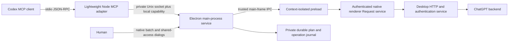

# Native ChatGPT conversation service

## Verified source and ownership

Initial implementation started from checkout commit
`8d26b54439498506b5057a4f2f25d40e30a27efb` of `mwheiss/hydex-desktop`,
whose upstream is `ilysenko/codex-desktop-linux`. The source now distributes the
signed official Linux package. Older generated output in `codex-app/` is not
the runtime contract.

The current official package inspected on 2026-11-06 is
`chatgpt_26.1103.31037_amd64.deb`, SHA-256
`32fed80ad3f8caf666e5860022361e9709d64aa318cfb19f548e8b458d4f6793`.
The repository's normal installer fetched and verified current signed stable
metadata, verified the package, and applied this feature. Its required
`quit-confirmation-focus` core descriptor failed against that package. The
installer correctly rejected the candidate; this feature does not bypass that
gate or claim an accepted application build. The subsequent Hydex full refresh
replays onto upstream `5e0a33793a3924067953f9a0fee691a47a26a60c`, including
the upstream Quit repair. Its signed-package inspection now passes with the
conversation API and the four required Hydex integration features enabled.

The renderer has an existing `Request` service exported alongside
`getChatGptRequestProfile`. Its requests pass through the desktop HTTP service,
which already owns native authentication. It supports `expectedIdentity`,
`assertRequestCurrent`, retry controls and response-header callbacks. This
feature reuses that service rather than reading cookies, session files or
tokens. It does not assume the web client's login/session endpoint is valid for
the desktop app.

The renderer account synchronization module holds a scope containing selected
account, authenticated account, authenticated user, token availability and
loading state. The feature hooks this synchronization after the application
updates account information. Every request validates that the selected and
authenticated identities agree, pins the native `expectedIdentity` and
`ChatGPT-Account-ID`, and checks identity before and after the native call.
`account_id` and `workspace_id` are both the native backend account identity in
this runtime; `user_id` distinguishes users within a workspace. The API does
not invent a separate global personal-account identifier. In particular,
`user_id` pins `authenticatedUserId`, the native request principal. The legacy
ChatGPT membership `userId` need not be the same identifier.
Native `requiresAuth` describes a provider requirement, which remains true for a
signed-in OpenAI provider. Readiness instead requires the loaded authenticated
account/user, matching selected workspace and native token availability; the
native Request service independently enforces that identity on each request.

The existing sidebar feature proves that ChatGPT and Codex can be mixed in
sidebar presentation. That presentation filter is not a data-access boundary.
This service calls only ChatGPT routes and excludes Codex-origin inventory
records. It never exposes the shared Codex app-server socket as ChatGPT history.
The reasoning-visibility feature changes the Codex transcript; it cannot make
unavailable ChatGPT private reasoning accessible.

## Process boundary

The feature's sole descriptor patches three boundaries with semantic anchors:
the existing main-process `isTrustedIpcSender` wrapper, the context-isolated
preload, and the renderer account-synchronization module. It discovers rspack
modules and follows the account and request-service imports. Chunk filenames
and minified identifiers are not pinned. Every anchor is validated before any
file is written; ambiguous, partial or drifted contracts fail closed. Reapplying
the exact patch/settings is idempotent; a different setting requires a fresh
official source build.

The native request loader is captured in the authentication module factory,
outside the account layout effect. That effect can shadow the minified loader
parameter with its account snapshot. An execution fixture verifies the patched
factory with this exact shadowing pattern; identity checks do not load HTTP.

Most implementation lives in ordinary staged CommonJS modules. The small
renderer/preload functions are serialized into their native bundles. The
preload exposes only registration, request subscription and response delivery.
Main-process IPC delegates to upstream sender validation and additionally
requires the main frame. A renderer can reply only to its own outstanding
random request ID. Different identities in separate windows produce an explicit
ambiguous-context error.

Main-frame document navigation retires the renderer registration and pending
requests. In-page history/fragment navigation preserves it: the same document
and account effect remain mounted, and every request still checks the current
identity. Each webContents receives lifecycle observers only once, including
across reloads.

The socket directory is 0700; the socket, discovery capability and ownership
record are 0600. Linux `/proc` process-start identities prevent PID-reuse
mistakes when reclaiming a stale bridge. A live socket is never unlinked.
Cleanup removes only the owning instance's inode identities. The Node adapter
can reconnect after shutdown/restart, but never automatically repeats a
mutation whose delivery is uncertain. The intended local trust boundary is the
owning Unix user plus possession of the private capability; this does not
isolate processes that already control that user.

## Verified native request contracts

These are fixed relative routes passed through the existing authenticated
`Request`, not a generic URL/request API exposed to MCP:

Project directory pages use the native client's limit of 20, and Project
conversation pages use 50. Larger public Project page limits are capped before
calling the backend and retain the next cursor. The live endpoint rejects a
directory limit of 100 with HTTP 422; zero embedded conversations is supported.
History/archive pages use 50 and advance by the backend's reported page limit.
The native exclusion value for Work chats is `tpp`; `codex` is not an accepted
value for that query. Explicit Codex/Work origins are also filtered from Project
inventory and rejected before raw, normalized or mutation-state output.

| Capability | Native request |
|---|---|
| History/archive inventory | `GET /conversations`, offset/limit, `is_archived`, `hide_snorlax=false`, `exclude_conversation_origin=tpp` |
| Native Project directory | `GET /gizmos/snorlax/sidebar`, cursor/limit, `owned_only=false`, no embedded conversations |
| Project contents | `GET /gizmos/{gizmo_id}/conversations`, cursor/limit, `owned_only=false` |
| Project identity/access | `GET /gizmos/{gizmo_id_or_short_url}` |
| Complete legacy tree | `GET /conversation/{conversation_id}` |
| Targeted metadata attempt for one chat | Read-only `POST /conversations/batch`, `{conversation_ids:[id]}`; no inventory scan. Live backend also returns message mappings, which the guard rejects; the cache uses a labelled per-chat body refresh fallback. |
| Older ordered messages | `GET /conversations/{conversation_id}/messages`, `before`, `num_turns`, `include_has_versions` |
| Rename | `POST /conversation/id/{conversation_id}/rename`, `{title}` |
| Move/unassign | `PATCH /conversation/{conversation_id}`, `{gizmo_id}`; empty string unassigns |
| Archive/unarchive | `PATCH /conversation/{conversation_id}`, `{is_archived}` |
| Private Project creation | `POST /projects`, name and empty instructions; optional verified `project_v2` memory scope |

The client also has a plural initial conversation endpoint. This feature starts
with the native full-tree endpoint to request all available branches. If it
returns ordered messages, older pages use the verified native paging route.
The current runtime does not establish a forward-message paging contract:
normalized retrieval fails explicitly if such a page is required; raw retrieval
can return preserved pages marked incomplete. Unknown message fields and
content types remain in raw/normalized content. Unknown conversation structures
remain inspectable in raw mode with `complete:false`; normalized mode reports
an unsupported-format error.

Inventory traverses ordinary history, archives, the complete Project directory
and each Project's complete cursor chain independently. It does not equate the
sidebar's initial Project previews with complete membership. Synchronization
runs as a cancellable job; stable snapshots are paginated only after the scan
stops. Metadata search and timestamp-based incremental selection use that
snapshot. There is no unverified early stop by update time. There is no content
index or automatic attachment download.

Every source reports advertised totals and exhaustion separately. Only stable,
consistent totals covering every enumerated source yield `confirmed_complete`.
An exhausted cursor chain with no authoritative total is `unknown`. The
observed Project directory contract lacks a guaranteed total, so it is expected
that live inventories will often have unknown account-wide completeness even
after every exposed page is fetched. Backend snapshot isolation is unavailable;
concurrent account changes/overlapping-page disagreement invalidate confidence.

## Schemas and fidelity

`runtime/tools.js` publishes strict input schemas for all 16 tools, with no
arbitrary JavaScript, URL, headers or backend request tool. It exports raw and
normalized output schemas as well. The normalized conversation includes its ID,
title, timestamps, Project/archive state, format, branch coverage, nodes and
messages. Each message includes author role, recipient, content type, structured
content, tool calls/output, model, visibility, attachment metadata, citations,
reasoning provenance, opaque reasoning field names, metadata and the complete
available raw message. Root/null-message nodes and alternate branches are
preserved. Parent-linked trees follow `current_node` for the active branch.

Raw output wraps the unmodified response objects in `pages`, except for
explicit credential redactions. Redaction paths are reported; unknown fields
are retained. Credentials such as authorization headers, cookie/token fields
and signed URL capabilities are excluded, even in raw mode. Redaction does not
scan ordinary message prose for instructions or reinterpret it as authority.
Conversation and message content are labelled untrusted throughout.

`thoughts`/`reasoning_recap` records are labelled client-supplied summaries or
activity, with their original content types and provenance. Opaque/encrypted
reasoning fields stay opaque. The API neither decrypts private reasoning nor
claims that a summary is complete internal reasoning. Binary attachments are
not fetched; unknown inline media pointers stay in structured content.

## Approval, execution and recovery

The individual mutation tools only stage previews. A preview captures an exact
canonical operation set, reasons, current state, proposed state, native account
and destination identity/access state. It is stored with a SHA-256 integrity
hash and a 24-hour expiry. One batch can contain up to 1000 operations, including
multiple sequential changes to one conversation.

`execute_approved_plan` accepts only `approval:"request-native"`. That value
requests a dialog and is not a consent token. The main process opens a native
dialog with the exact plan/account/hash and defaults to Cancel. Shared or
unknown-access destinations need the separate feature setting and a second
access-authorization dialog. The service rechecks plan bytes, native identity,
conversation state and destination sharing after the dialog and before sending
mutations. A consumed plan cannot start a second job.

The executor serializes requests, enforces request spacing, disables transport
mutation retries and honors `Retry-After`. Every operation has a durable intent
record written before sending, then backend verification and a durable result.
Verification is bounded. Failures stop the batch with per-operation results.
Rate-limited operations can resume after cooldown and fresh native approval.
An uncertain/interrupted operation is first read back: if its exact proposed
state is present, it is recorded verified without a repeat; otherwise it stays
paused for reconciliation. Unknown Project creation results never trigger
another blind creation. Desktop shutdown aborts work and preserves journaled
intent/results. Cleanup starts in `will-quit`, after upstream's native Quit
confirmation accepts shutdown; cancelling a Quit prompt leaves the API active.
A new owner marks running jobs interrupted before recovery.

Undo creates and approves an inverse plan in reverse operation order. It
restores only recorded verified changes and fails on intervening edits.
Created Projects remain. There is no permanent deletion, atomic backend
transaction, cross-client write lock or guaranteed rollback. The backend does
not expose a proven conditional-write/version precondition here, so a user edit
between the final read and write cannot be ruled out. Post-write verification
detects disagreement; it cannot make that window atomic.

## Validation boundaries

Feature tests cover realistic mapping/message fixtures, pagination, archives,
Project coverage, tool messages, summaries, opaque and unknown fields,
credentials, schema errors, account changes, plan integrity, approval denial,
shared access, concurrent updates, rate limits, partial failures, cancellation,
resume, shutdown recovery and undo. The stdio integration test exercises the
actual MCP adapter, socket, trusted main IPC and renderer functions against a
synthetic native request service.

`fixtures/demo.js --codex /path/to/codex` additionally uses a real Codex app-server's
`mcpServerStatus/list` and `mcpServer/tool/call` in an ephemeral configuration.
It performs the agent workflow against the simulated backend, including
approval denial, externally granted fixture approval, execution and undo. It
starts no model turns, copies no credentials and edits no existing Codex config.
`fixtures/audit-bundle.js` checks both read-only and mutation-enabled patch settings,
idempotence and JavaScript syntax directly against the verified official ASAR.

No live-account history reads or mutations have been performed for this
implementation. A running feature-enabled desktop with the user's existing
session still needs read-only acceptance. A live mutation remains subject to
separate explicit authorization, beginning with one reversible operation.
Arm64 shares the source but has not been live-validated. The initial required-core
patch failure is resolved by the subsequent upstream replay. Native release
build, package and publication acceptance are recorded separately in the full
refresh's release reports; a successful ASAR inspection alone is not a package
or live-account acceptance result.

## Research leads

The supplied references informed the questions investigated; their endpoints
were not treated as desktop contracts and their code was not copied:

- [Conversation Manager](https://github.com/BrianMills2718/chatgpt-conversation-manager): inventory, pagination and native Project coverage.
- [Conversation Export format](https://github.com/ThierryAbalea/chatgpt-conversation-export/blob/main/docs/format.md): mapping trees, ordered arrays, branches and tool content.
- [txcript ChatGPT format](https://github.com/skillsynchq/txcript/blob/main/docs/formats/chatgpt.md): raw records versus transcript fidelity.
- [AI Bulk Chat Manager](https://github.com/ehsanenaloo/AI-Bulk-Chat-Manager): archive pacing and rate-limit research lead; authoritative behavior here comes from the inspected native application and synthetic tests.
